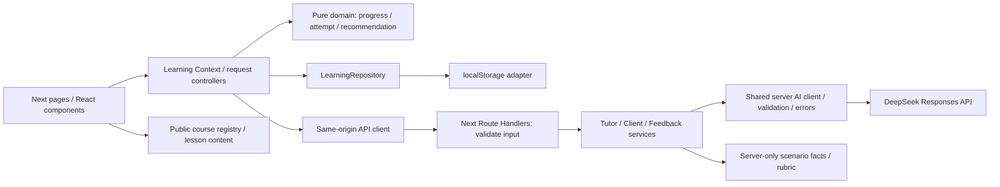

# Technical Plan — COMP5241 Mini-course Learning Platform

- 日期：2026-10-17（Asia/Shanghai）；目标展示：2026-10-19。
- 状态：**技术方案待用户审核；尚未授权开始 implementation。**
- 功能与验收依据：[SPEC.md](SPEC.md)，重点为 FR-001–FR-023、AC-001–AC-032。
- 背景：[REQUIREMENTS_DISCOVERY.md](REQUIREMENTS_DISCOVERY.md)、[老师要求](project_overview_中文翻译.md)、[会议纪要](10.17会议纪要.docx)。后两者不扩大个人 Prototype 范围。
- 任务：[TASKS.md](TASKS.md)；案例：[SCENARIO.md](SCENARIO.md)；课程编排：[COURSE_CONTENT_PLAN.md](COURSE_CONTENT_PLAN.md)。

## 1. Planning baseline 与范围保护

本轮将 Specification 转为可实现、可验证的方案，只创建上述四份 Markdown 文档，不初始化应用、不安装依赖、不编写业务代码、不调用付费模型、不部署、不提交 Git。

仓库检查结果：根目录只有 `.git/`、`.agents/`、`docs/`；无应用代码、package manifest 或现有测试。已安装项目技能为 context-engineering、interview-me、planning-and-task-breakdown、spec-driven-development。本轮使用前者与 planning-and-task-breakdown 的上下文、依赖、任务与验收方法；输出位置按用户要求为 `docs/PLAN.md`、`docs/TASKS.md`，不另建重复任务清单。

起始 `git status --short` 为 `?? docs/SPEC.md`，保留此已有文件；最近提交为 `5e6a4be docs: define prototype requirements`、`de5a49b chore: add initial agent development skills`、`6594587 docs: add project requirements and meeting notes`。未发现适用的 AGENTS.md。Git 只在本次命令中使用 `-c safe.directory=...` 读取，不修改全局 Git 配置。

SPEC 页首仍记载“待审核、尚未进入 Technical Plan”，§18 多处“本轮不选定”描述的是 Specification 阶段；用户当前明确要求进入 Plan，故本文件给出这些事项的具体提案，不修改 SPEC 的功能、ID 或历史状态。团队规范尚未提供，个人接口不是团队已确认标准。

冻结范围：1 个完整 Course、1 Module、3 Lessons、1 固定 Activity；多个课程入口中只有 Demo 可学习。Tutor / Client / Feedback 正常路径真实 AI。无登录、云数据库、PDF Upload、RAG、Multi-Agent、provider failover、总分、及格线、完整 Teacher workflow。**AC-001–AC-032 全部通过之后才可考虑 Teacher Should；本任务清单不包含 Teacher 实现。**

## 2. 推荐技术栈与 OID 决策记录

以下 Decision 是本次个人 Prototype 的推荐实现基线，等待整体审核；不是对团队技术栈的承诺。

### OID-01 — 工程、框架、组件与测试

- **Decision：** Next.js App Router + React + strict TypeScript；Tailwind CSS；Lucide React；npm 与单一 lockfile；Node.js 22.x。复用自有 Button、Card、Field、Status、Progress、Chat 等小组件，首版不安装 shadcn/ui。Vitest 测纯逻辑和 API 契约，少量 React Testing Library 测有状态交互，Playwright 测核心浏览器流程。
- **Why：** 页面、服务端 AI 入口和类型在一个仓库内；不需另维护后端部署。Tailwind 适合快速统一学习界面，Lucide 保持图标一致。当前控件主要为链接、表单、卡片、可展开区和消息列表，原生 HTML 足够，不需组件库基础设施。
- **Alternatives considered：** Vite + React + 独立 API；Next.js + 全套 shadcn/ui；Redux / Zustand；MDX / CMS。
- **Why alternatives were not chosen：** 分离 API 增加部署和契约维护；全套组件库容易把版式带向管理后台；当前一个学习状态域可由 reducer + Context 支撑；三个短 Lesson 不值得增加内容管线。若实施时出现确需复杂可访问控件的具体需求，再单独评估该控件，不整库引入。
- **Impact on Student Must：** 支撑 FR-001–FR-023，尤其无登录部署、响应式和状态一致性；不新增用户步骤。
- **Risks：** App Router 服务端 / 客户端边界、依赖兼容和 localStorage hydration。T001 在实施当日选官方仍支持的稳定发布、锁定精确版本和 Node 配置，不使用 canary；本轮没有实际解析依赖，因此不虚构 patch 版本或已通过构建。

拟提供命令：`npm run dev`、`npm run build`、`npm run start`、`npm run lint`、`npm run typecheck`、`npm run test`、`npm run test:e2e`、`npm run test:ai:live`。它们由 T001–T003 创建，现在不能执行。`lint` 用 ESLint CLI，不依赖某一 Next 专用旧命令。实施时核对[Next.js 安装要求](https://nextjs.org/docs/app/getting-started/installation)和[Vercel 支持的 Node.js 版本](https://vercel.com/docs/functions/runtimes/node-js/node-js-versions)，避免本地与部署版本漂移。

### OID-02 — AI provider / model / 调用 / 成本

- **Decision：** 单一 **DeepSeek** provider；三个用途共用 **`deepseek-flash`**。保留官方 OpenAI JavaScript SDK 作为兼容客户端，固定 `baseURL=https://api.deepseek.com`，只在 server-side 读取 `DEEPSEEK_API_KEY`；可选 `DEEPSEEK_MODEL` 仅允许同一模型。Responses API 按用途分离：**Tutor 使用 `text.format.type=text`，提取/trim/非空/长度验证后返回 string；capability、Client、Feedback 等结构化操作保留 `json_object` + JSON.parse + Zod runtime validation**。这是本轮用户明确授权的 T015 contract 修正：两次独立 JSON-mode 追问返回 completed 纯空白，JSON prompt 缓解未解决。普通 POST JSON envelope、完整响应后展示；不做 streaming、tools、agent loop 或 provider failover。SDK 自动 retry 显式关闭，由学生 Retry 触发一次新 application request。
- **Why：** 用户于 2026-10-18 明确授权从 OpenAI 迁移至 DeepSeek，旧 provider 不再是 active configuration。兼容端点保留现有 SDK / transport 边界。官方 Responses API 已明确支持该模型、JSON Output 和 `reasoning.effort=none`；JSON 模式不代表保证应用的精确 schema，必须在应用侧验证。账户访问与真实能力仍须由 T003 证明，教学语义仍须通过 T021、T028 验证。[官方 Responses API](https://api-docs.deepseek.com/api/create-response/)、[JSON Output 指南](https://api-docs.deepseek.com/guides/json_mode/)。
- **Alternatives considered：** 更大的旗舰模型；另一供应商；Vercel AI SDK / AI Gateway；直接手写 fetch。
- **Why alternatives were not chosen：** 未有固定案例需要旗舰的证据；多个供应商 / Gateway 增加账户与行为变量；本轮不需要跨 provider 或 streaming 抽象；手写 SDK 处理会重复错误与解析逻辑。未选方案不作为隐式 fallback；若真实评测不达标，提出明确模型变更，不自动切换。
- **Impact on Student Must：** 三个正常路径都真实调用 AI；Feedback 只有结构及语义契约有效才算成功。Client 用 AI 理解问题和选择披露事实，具体事实由案例约束，见 §6。
- **Risks：** API key、地区和服务端网络可达性、模型权限、余额、延迟、拒答与成本。模型别名可能由 provider 更新，不是固定 snapshot。缺 key 或离线测试通过均不代表真实能力已验证；部署地区能力另行核实。

**调用与预算提案：** 复用一个服务端 client；每次用户操作最多一次 provider 请求。Tutor 输出上限初设 900 tokens，Client 开场 / 意图选择 600，Feedback 4,500，capability 128；通过 DeepSeek 明确支持的 `reasoning.effort=none` 关闭 thinking。结构化请求明确包含 json 与目标格式；capability 提供极小 JSON 示例。拒绝空内容、截断、无效 JSON 和 schema mismatch，不自动补发。T015 transport 修正复用 P01 已验证方案：所有操作的 SDK 默认及单次 request timeout 为 60 秒，独立的 Undici connection timeout 也明确为 60 秒；每次请求使用同一共享路径创建并 finally 销毁 dispatcher，避免 Tutor 落回默认约 10 秒连接上限。前端 AbortController 等待 65 秒，live harness 等待 67 秒，以容纳 provider 的 60 秒预算和错误返回；这些是有限的技术上限，不是学习限时或完成门槛。平台实际支持值在 T037 核对。

不沿用旧 provider 的价格估算；实际成本按 DeepSeek 当时定价与返回 usage 核算。本轮用户已授权最小 capability check：一次极小 JSON 响应同时验证普通模型响应、网络、模型访问与结构验证，满足后停止，不做重复付费检查。原建议 **US$10** 的整体开发预算仍待确认，不代表已消费、已获账户额度或已设置硬限额。记录 operation、provider、耗时、model、token usage 与 request ID，不记录 key、完整 prompt 或学生全文。不以无状态函数内计数器声称实现了全局预算控制。

### OID-03 — 本地持久化与状态组织

- **Decision：** React reducer + Context 管理学习状态；`LearningRepository` 隔离存储；`LocalStorageLearningRepository` 实现同源本地恢复。持久化一个版本化快照，详见 §5、§8。
- **Why：** 数据量小，无二进制或查询需求；localStorage 可跨刷新与关闭保留，容易整体校验与原子替换一个键。业务逻辑不接触浏览器存储。
- **Alternatives considered：** sessionStorage、IndexedDB、直接在组件内读写、云数据库。
- **Why alternatives were not chosen：** sessionStorage 不满足关闭恢复；IndexedDB 此时增加事务和升级成本；散落读写容易覆盖状态；云数据库在排除范围。
- **Impact on Student Must：** 覆盖 SPEC §13 五类恢复内容；失败保留已有结果；不追加未完成全文草稿的跨关闭恢复承诺。
- **Risks：** SSR 初值覆盖存储、浏览器禁用 / quota、内容版本变化、跨标签页竞争。hydration 完成前禁止 save；异常保留内存状态和已有原始数据，不静默清空。首版单标签页使用，不宣称多标签页实时同步。

### OID-04 — 部署

- **Decision：** Vercel 一个 Next.js 项目，页面与 Node Route Handlers 同源部署；采用固定生产 URL 展示，Preview 仅作预验收。服务端配置 `DEEPSEEK_API_KEY`（可选 `DEEPSEEK_MODEL=deepseek-flash`），不加 `NEXT_PUBLIC_` 前缀。
- **Why：** 与 Next.js 单仓库匹配，发布、日志、回退路径直接；浏览器只访问本网站 API。Next Route Handlers 可作为普通 HTTP 服务端入口。[部署与 Route Handler 依据](https://vercel.com/docs/llms-full.txt)。
- **Alternatives considered：** 静态导出；前后端两个主机；Cloudflare 等其他平台。
- **Why alternatives were not chosen：** 静态导出不能承载所选服务端 AI 入口；拆分部署没有本轮收益；不增加另一平台适配变量。
- **Impact on Student Must：** 交付无登录可访问的完整 Student 流程；正式验收必须在部署 URL 用真实 AI 复测，不仅在 localhost。
- **Risks：** 账户权限、函数区域 / 时限、访问保护、浏览器到网站及网站到 provider 的网络。T037 准备具体配置，T039 在后续明确授权部署后发布；生产链接需无登录可访问。Preview 与生产不同 origin，localStorage 不自动迁移，故关闭恢复验收使用同一生产 origin。

### OID-05 — 固定 Scenario

- **Decision：** 固定“校园社团活动报名工具”，案例 ID `club-signup-v1`，完整故事、隐藏事实、优先级、披露表和评价参照见 [SCENARIO.md](SCENARIO.md)。
- **Why：** 初学者熟悉，用户与组织者需求可区分；名额、确认、满额处理、上线时间能自然引出八栏目，避免复杂集成。
- **Alternatives considered：** 考试复习规划、医疗预约、通用电商。
- **Why alternatives were not chosen：** 复习工具容易偏向内容生成 / 推荐；医疗和电商引入额外领域、账户或支付背景；该案例用一条报名流程即可保持挑战。
- **Impact on Student Must：** 满足 FR-006–FR-011、FR-020；案例内的 Must / Should / Could 仅描述虚构客户产品，不新增平台 Must。
- **Risks：** 开场泄露、案例事实误入浏览器 bundle、课程例子提前给答案、事实选择像关键词匹配。服务端事实边界、语义 AI 选择、不同案例的课程例子及 live 检查共同处理。

### OID-06 — 三个 Lesson 的最终编排

- **Decision：** 保留 SPEC 三个标题与教学重点；每课正文目标约 140–180 个英文词，配一个软件例子和少量提示，详见 [COURSE_CONTENT_PLAN.md](COURSE_CONTENT_PLAN.md)。内容作为类型化静态数据进入课程 registry，首版不运行时生成课程。
- **Why：** 保持课短且稳定，节省大部分时间给提问与八栏整理；静态正文便于评审、Tutor 精确取当前课上下文。
- **Alternatives considered：** 长教材、全部动态 AI 生成、视频、MDX / CMS。
- **Why alternatives were not chosen：** 增加时长、生成不确定性或内容工具链，不帮助既定 Student 闭环。
- **Impact on Student Must：** 覆盖 FR-003、AC-004；本轮给出完整 outline，T007 才制作最终短正文。
- **Risks：** 初学者整理八栏耗时、阅读估时偏差。完整试学目标 10–15 分钟；若偏长，压缩文案和重复解释，不删栏目或增加自动代写。

### OID-07 — 语言策略

- **Decision：** UI、Lesson、案例、字段标签、Tutor / Client / Feedback 输出统一为简明英文；专业术语采用 SPEC 英文标签，并在首次出现时用简单英文解释。规划文档继续用中文。用户输入不设英文校验门槛，AI 可理解中文问题 / 总结，但正常回复仍用英文。无语言切换和 i18n 系统。
- **Why：** 降低同一内容双份维护与 prompt 分支，适合课程展示和后续团队讨论；以短句、术语释义支持 beginner。
- **Alternatives considered：** 全中文；中英双栏；自动跟随每条输入切换 UI / AI 语言。
- **Why alternatives were not chosen：** 全中文与既有课程 / 字段名需额外对照；双栏和动态切换增加内容量、状态和一致性成本。
- **Impact on Student Must：** 不改变八栏目、教学目标或学习规则；不因输入语言拒绝总结。
- **Risks：** 英语阅读速度影响 10–15 分钟；T036 由初学者试学验证。此方向需要用户随计划确认。

### OID-08 — Module 与 Course 进度

- **Decision：** 唯一 Module 包含三个 Lesson 与一个 Activity。主呈现为“3 lessons: x/3 · Activity: incomplete/complete”；辅助进度为四个完成单位等权，`completedUnits / 4`，显示 0 / 25 / 50 / 75 / 100%。Module 与 Course 同一集合聚合，不单独存百分比。
- **Why：** 当前唯一 Module 无需复杂权重，四个单位可直接对应真实完成动作。
- **Alternatives considered：** 阅读时间权重、AI 成绩权重、仅按 Lesson 计算。
- **Why alternatives were not chosen：** 前两者引入未确认规则；只计算 Lesson 会使 Activity 未完成时进度误示 100%。
- **Impact on Student Must：** Lesson 仅显式点击完成；Activity 仅有效 Feedback 后完成；Course 仍为四项全完成。百分比是展示，不是分数。
- **Risks：** 重练中的新状态与已经取得的完成记录混淆。主进度保留已取得成果，另显示“Current practice: in progress / awaiting feedback”，详见 §5。

### OID-09 — 团队整合

- **Decision：** 个人原型内采用 camelCase 字段、稳定字符串 ID、PascalCase React 组件；纯 domain 逻辑与 React / provider / storage 分开。输出本计划中的 contracts 和 module map 供 10 月 19 日讨论。团队技术栈、共享字段、UI 规范均标记为 **待团队确定**。
- **Why：** 能独立交付，又能按边界替换 provider、内容来源和 persistence adapter；无需微服务或可插拔平台。
- **Alternatives considered：** 等待团队标准后再规划；自行宣称全组采用该规范；提前做 monorepo / 组件包。
- **Why alternatives were not chosen：** 前者阻塞个人交付；后两者越权或增加打包工作。
- **Impact on Student Must：** 无额外用户能力；不会为等团队规范推迟无登录 Student 闭环。
- **Risks：** 团队最终栈不同可能需要适配。可复用的是案例、schema、reducer、推荐规则和组件概念，不承诺零修改迁移。

### OID-10 — AI 约束与推荐映射

- **Decision：** Tutor 用当前 Lesson allowlist；Client 用真实 AI 的结构化提问意图 / 事实选择 + 服务端固定事实渲染；Feedback 用固定九项评价结构、证据引用校验与非数值问题代码；纯函数将有效评价映射到 Lesson / Retry / Complete，见 §6–§7。
- **Why：** 让教学解释、客户扮演和评价各有边界；完成状态不交给模型；推荐链接及 next action 共享同一个计算结果。
- **Alternatives considered：** 一条大 prompt 自由返回所有文本；模型自由选择 URL；数值总分 / 阈值；让 Tutor 自动写总结。
- **Why alternatives were not chosen：** 无法可靠控制事实、结构、链接或教学产出；总分和代写改变已冻结规则。
- **Impact on Student Must：** 覆盖真实 AI、九项等级、三类反馈、可执行推荐；不增加必须提问次数、使用 Tutor 或成绩门槛。
- **Risks：** 结构正确不等于评价正确；语义意图和等级仍可能误判。通过具体证据、固定评测输入和 live 人工核对发现，不通过补造成功结果兜底。

### OID-11 — UI 表达与响应式

- **Decision：** 以“短课程学习桌面”组织：暖白背景、深色正文、单一青绿色主行动、少量杏色提示；圆角卡片、克制图标、清晰阅读层级。桌面正文为主，Tutor 为旁栏；窄屏切成正常文档流中的可展开 Tutor，Activity 按 Chat → Summary → Feedback 组织。
- **Why：** 学习材料和下一步行动更突出，温和视觉降低练习压力；不需要装饰图片、排行榜或聊天全屏首页。
- **Alternatives considered：** 高密度管理 dashboard、所有页面套同一聊天模板、强游戏化、多色渐变大 hero。
- **Why alternatives were not chosen：** 与短课程与自行整理需求的任务不匹配，分散阅读和操作。
- **Impact on Student Must：** 满足 FR-021–FR-022；loading / error / empty / complete 见 §9；颜色不作为唯一状态信号。
- **Risks：** 旁栏挤压正文、手机键盘遮按钮、八栏过长；通过流式布局、显式标签和连续缩放走查修正。颜色值与间距在 T004 定稿，不在本轮实现页面。

## 3. Architecture 与依赖方向

普通 HTTP 请求 / 响应是全部后端工作负载。没有后台队列、工作流、常驻会话服务或云持久化。服务端无状态，每次请求携带必要的当前上下文；不把内存当作可持久学习记录。Tutor、Client、Feedback 是三个用途明确的函数，不是三个 agent。

建议模块位置（**未来文件结构，本轮不创建**）：

| 模块 | 位置 | 负责 / 不负责 |
| --- | --- | --- |
| 路由与布局 | `src/app/` | 页面组合、URL 参数检查、loading / not-found；不包含推荐规则。 |
| 复用 UI | `src/components/ui/`、`src/features/*/` | 语义控件与学习交互；不读取 provider key 或 localStorage。 |
| 课程公共数据 | `src/content/courses/` | registry、公开标题与 Lesson blocks；无隐藏事实、rubric 或完整答案。 |
| Domain | `src/domain/` | 类型、schema、状态转换、progress selectors、recommendation；不依赖 React / Next / SDK。 |
| 学习运行状态 | `src/state/` | reducer provider、请求生命周期、快照提交与 hydration。 |
| Persistence | `src/persistence/` | repository interface、快照校验、localStorage adapter。 |
| 浏览器 API | `src/lib/api/` | fetch、标准错误、abort；不接触 provider SDK / key。 |
| 服务端 AI | `src/server/ai/` | 单例 SDK、purpose services、prompts、响应校验、错误标准化。 |
| 服务端案例 | `src/server/scenarios/` | 固定事实、披露规则、Feedback rubric；入口 `server-only`。 |
| 测试 | `tests/unit/`、`tests/api/`、`tests/e2e/`、`tests/live/` | 分层验证；live 需显式命令和凭证，普通测试不扣费。 |

公开模块不能重新导出 server-only 内容；Route Handler 返回最小 DTO，不序列化整个 scenario 对象。`docs/SCENARIO.md` 是开发参照，包含答案，但不作为学生页面或静态资源发布；公开仓库的读者仍可查文档，本轮不是防作弊考试系统。

## 4. Course domain 与 content boundary

| Model | 最小字段 / 关系 |
| --- | --- |
| CourseCard | `id, slug, title, description, availability`；availability 为 available / comingSoon，comingSoon 没有学习路由或推荐目标。 |
| Course | `id, slug, title, contentVersion, moduleIds`；Demo 为 `requirement-clarification`。 |
| Module | `id, courseId, title, lessonIds, activityIds`；Demo 一个 `clarification-basics`。 |
| Lesson | `id, courseId, moduleId, order, title, objective, blocks, tutorContext`；ID 为 `why-clarify`、`what-to-ask`、`structure-requirements`。 |
| Activity | `id, courseId, moduleId, kind: clientRoleplay, scenarioId, summaryFieldIds`；ID 为 `client-interview`。 |
| LessonBlock | `kind, text`；kind 为 concept / example / term / prompt，纯文本块，不执行任意 MDX / HTML。 |

Course registry 是 `courseId → published Course`，Dashboard 另包含 Git basics、Working with AI coding agents 等 Coming Soon cards。增加未来完整课程时添加其数据和内容，页面通过 ID 读取，不复制三份页面；本轮不制作这些未来课程。Demo 的 1/1/3/1 约束由数据验证检查。

`tutorContext` 包含当前课 objective、核心概念、术语解释、例子、允许话题和不应代写的活动边界；由服务端按合法 lessonId 读取。浏览器不能提交 system prompt 或替换课程正文。

StructuredSummary 固定八个字符串字段：`targetUser, userGoal, coreRequirements, constraints, priorities, userFlow, acceptanceCriteria, outOfScope`。标签严格对应 SPEC §9。提交 schema 要求八个键存在，但**允许空字符串**，由 Missing 反映遗漏；不使用 HTML `required` 或最少字数阻止不完整总结获得反馈。空白不是隐式失败；AI 输出错误才是请求失败。

## 5. Learning state 与完成不变量

### 5.1 状态分层

| 状态 | 内容 | 生命周期 |
| --- | --- | --- |
| `CourseLearningState` | `completedLessonIds, currentLessonId, earnedActivityCompletion, latestAttemptMeta, latestSuccessfulResult` | 可序列化；需要的内容经 repository 保存。 |
| `ActiveAttempt` | `attemptId, phase, transcript, summaryDraft, submittedSnapshot, pendingRequest, error` | 当前浏览器会话内；换路由通过顶层 provider 保留。 |
| `LatestSuccessfulResult` | `attemptId, scenarioVersion, summarySnapshot, feedback, recommendation, receivedAt` | 保存最近一次有效结果，不做历史列表。 |
| `TutorSession` | 每课的 messages、当前 input、failed request snapshot | 会话内保留；不参与完成计算。 |
| 派生值 | Module / Course completed、进度百分比、未完成 Lesson | selectors 计算，不重复持久化。 |

`phase` 区分 `notStarted → openingPending → interviewing → summary → feedbackPending → completed`；错误是对应 phase 的 request status，不把它转换为 completed。`requestId + attemptId + submissionId` 标识请求与提交，过期结果不落入新练习。

### 5.2 转换与不变量

| 事件 | 允许变更 | 必须保持 |
| --- | --- | --- |
| `LESSON_OPENED` | 当前 lessonId | 不增加 completedLessonIds。 |
| `LESSON_COMPLETED` | 幂等加入合法 lessonId，重算 progress 与当前建议 | 不依赖阅读 / Tutor / 评价。 |
| `SUMMARY_SUBMITTED` | 固化本次八栏 + 完整已有 Client transcript；phase=pending | 不完成 Activity；旧结果保留。 |
| `FEEDBACK_SUCCEEDED` | 验证通过后一次 reducer 事件写入结果、推荐、该 attempt 完成及 earnedActivityCompletion | 必须关联相同提交；不能用缺维度 / 空反馈完成。 |
| `AI_FAILED` | 当前请求错误与 Retry snapshot | 输入、对话、总结、完成记录和旧结果不清除。 |
| `RETRY_REQUEST` | 对同一失败 snapshot 发起请求 | 不重复插入 user turn，不开始新 attempt。 |
| `RETRY_ACTIVITY` | 新 attemptId、新对话 / 草稿，current attempt 未完成 | 同一 scenario；保留已获得完成记录与最近成功结果。 |

Course completion = 三个 Lesson 均显式完成 **AND `earnedActivityCompletion` 有有效成功记录**。Module 同集合计算。等级弱也可以已完成，等级强也不能补全未点击的 Lesson。

**重练语义：** 已取得的完成记录单调保留；新练习 pending / failed 不算新一次完成。Progress 可显示“Course complete; current practice in progress”，最近 Feedback 标明来自上一次成功练习，不伪装成本次结果。首次练习失败则 Activity / Course 不完成。成功的新练习一次替换最近结果，无需历史列表。此设计落实 SPEC §12“失败保留已有学习状态和已获得结果”，不把 Course 完成当能力认证。

Feedback 请求时禁止重复提交；保留已提交快照，允许返回阅读，不能在同一请求中混入后来编辑。若学生开始重练或状态已换 attempt，迟到响应只被忽略。未提出问题也允许提交，questioning process 可为 Missing，不加次数门槛。

## 6. AI service contracts 与真实 AI 边界

### 6.1 共享调用层

浏览器只调用三条 POST：`/api/ai/tutor`、`/api/ai/client`、`/api/ai/feedback`。统一 envelope 为成功 `{ok:true, requestId, data}` 或失败 `{ok:false, requestId, error:{code,message,retryable}}`。服务端负责合法 course / lesson / scenario ID、输入结构和合理 payload 大小（初设 256 KiB）校验；不按固定提问次数限制完成。

同一个 server-only provider 复用 SDK client，提供 `requestTextResponse`（仅 Tutor）与 `requestStructuredResponse`（capability / Client / Feedback）两个明确接口，共享一次 SDK 请求、response/content 提取、timeout、无自动 retry、refusal / incomplete 检测、usage 日志和安全错误映射。Tutor 的合法 output_text 经 trim 后须为 1–4000 字符；不进行 JSON.parse、不要求模型输出对象或相关性 flag。结构化操作继续使用 JSON Output → JSON.parse → Zod.safeParse；无效模型 JSON 诊断为 JSON_OUTPUT_FAILURE，schema mismatch 仍为 SCHEMA_VALIDATION_FAILURE，Tutor 空文本诊断为 TEXT_OUTPUT_FAILURE。DeepSeek Responses API 无状态；不发送 `store`，不使用服务端持久会话。JSON 模式不保证符合应用 schema 或事实正确，服务端仍做证据与允许值校验。[兼容性依据](https://api-docs.deepseek.com/guides/responses_api/)、[JSON Output](https://api-docs.deepseek.com/guides/json_mode/)。

标准错误：`INVALID_INPUT`、`UNAVAILABLE`、`TIMEOUT`、`RATE_LIMITED`、`REFUSED`、`INVALID_AI_RESPONSE`、`NOT_CONFIGURED`。保留应用语义；服务端 capability 另提供白名单诊断，区分认证、模型访问 / 不存在、余额、限流、网络、超时、请求参数、JSON / schema 与 provider 错误，不携带原始错误或 cause。余额不足按官方 HTTP 402 识别。[官方错误码](https://api-docs.deepseek.com/quick_start/error_codes/)。浏览器文案用“Unable to get feedback. Your work is still here. Retry.”等简短英文，不展示 provider 原始错误、栈或 key。任何失败不返回模拟成功结果。鉴权 / 配置错误也保留工作，Retry 仍可用，服务条件修复后重试。

API key 只在 `src/server/` 读取；没有浏览器直连 SDK、公开环境变量或客户端可选模型。AI 文本以 React text 渲染，不执行 HTML。不复制三套 fetch、SDK 初始化、错误组件。请求控制器由应用 provider 持有，路由间导航不直接销毁已提交工作。

### 6.2 Tutor

输入：`courseId, lessonId, question, conversation`；server 用 ID 读取当前 Lesson context，保留该课相关追问。历史与用户内容作为数据，不能覆盖系统约束。模型直接输出自然语言教学文本，provider 返回验证后的 string，application envelope 为 `{ok:true,requestId,data:string}`；浏览器用 string schema 验证协议数据，session 保存实际显示的文本，不向模型发送 JSON wrapper。Tutor 不要求 JSON Output、模型对象 schema 或 relatedToLesson flag。回答仍须简短解释、举例、简化或相关追问；不输出 scenario 隐藏信息、完整八栏答案、进度修改或任意课程推荐。

明显越界请求返回简短的学习边界说明并引回当前知识点，仍是实际 AI 请求；不变成通用 ChatGPT。Tutor 不接收 server scenario facts / rubric。切换 Lesson 使用对应会话，避免旧 Lesson 混入。失败保留 input 与 messages，Retry 使用完全相同的 failed snapshot；成功后才添加对应 assistant turn。

### 6.3 Client：AI 理解 + 受控事实披露

输入：`scenarioId, attemptId, mode: opening|turn, transcript, question`。服务端按 transcript 中已经返回的 fact IDs 恢复已披露集合，并校验它们属于当前 scenario；浏览器披露 ledger 不是可信评分或权限凭据，本原型不承担防作弊安全目标。

**开场真实调用 AI：** 只向开场生成请求提供公开背景与模糊请求，不传 hidden facts / rubric；要求简短第一人称提出“更容易报名”的模糊需求。返回 `{opening}`，不在 API 失败时用写死开场冒充成功。SCENARIO 的 initial request 是 prompt 内容依据，不是无模型的正常返回。

**后续每个问题真实调用 AI 一次：** AI 根据学生问题和已有公开对话，输出受约束的 `responseAct`、`requestedFactIds` 与引用当前问题的 `questionEvidence`。输入包含事实主题目录（如 users / goal / capacity / confirmation），不含未披露事实的具体值；模型做语义理解、追问指代与相关事实选择，不做关键词自动回复。

服务端 disclosure policy 检查引用确在当前问题中、fact IDs 合法、与所问主题匹配，并按 SCENARIO 表最多选择两个相关 fact groups。笼统“告诉我所有答案”不自动开放全部；只返回澄清主题的提示。相关已披露事实可重述；用户提出相反假设时，重述同一固定事实，不改写目标、人数、优先级或范围。

**事实输出正文由服务端使用该 fact 的固定第一人称自然句渲染，连接与澄清话术采用有限 responseAct。** 这样模型无法发明名额或隐含需求；仍由真实 AI 对每个问题决定适当信息，固定内容只是案例事实，不是预生成整段聊天或失败 fallback。API 只返回最终可见回复及已披露 fact IDs，不返回目录、未披露 values 或完整答案；不让模型自由填充不可验证的事实文本。此取舍优先固定案例的稳定性，真实语义理解仍需 live 验证。

广泛问题、不同表达、复合问题、重复问题、否定假设、请求代写、prompt injection 分别测试；如果事实选择与问题不符，按 invalid response 报错供 Retry，不输出未经批准事实。不是 RAG、工具循环或多 Agent；所有数据为单一固定案例内部定义。

### 6.4 Feedback

请求输入：`courseId, scenarioId, attemptId, submissionId, transcript, summarySnapshot`。服务端取相同版本的完整案例事实与 rubric，结合学生实际对话和八栏总结，真实调用模型一次，返回 validated assessment。模型不得把固定案例的标准答案当作学生已问 / 已写证据。

建议 assessment schema（字段约定，不是本轮代码）：

| 字段 | 契约 |
| --- | --- |
| `questioning` | 一个独立 DimensionAssessment，评价真实提问目的、覆盖与追问。 |
| `dimensions` | **固定对象**，键为八个 SummaryFieldId，避免数组漏项 / 重复项；每项一个 DimensionAssessment。 |
| `DimensionAssessment` | `level, explanation, evidence[], problemCodes[]`；level 仅 Strong / Partial / Missing。 |
| `evidence[]` | `source, turnId, fieldId, quote, factId`；source 为 turn / summary / absence，其他字段按需为 null。非空 quote 必须是实际输入子串。absence 指出未见哪类提问 / 总结，不伪造引文。 |
| `problemCodes[]` | 有限枚举：`goalMisunderstood, questioningGap, summaryGap, minorOmission`；与维度和等级一致，供规则选择复习目标。 |
| `whatWentWell[]` | 有依据的简短优势；无证据时可为空，UI 如实说明，无编造赞扬。 |
| `whatToImprove[]` | 具体遗漏 / 错误及可行动改进；良好时可为空，UI 显示未发现实质遗漏。 |

每个维度都有非空 explanation；Strong 不带 gap；Missing 必有 absence 或有效证据与 gap；非空 quote、turnId、fieldId、factId 均验真；不得引入总分。结构 / 引用错误整体视为失败，保留原提交。复杂语义评判仍由模型完成，人工 live 核对其准确性，不声称子串校验能证明等级合理。

应用层 `buildLearningResult(assessment, progress)` 补入唯一 `recommendedNextAction`，形成完整 FeedbackResult；Feedback 区块和 RecommendationCard 读取同一 action，避免模型建议与按钮相反。**三类必需反馈**分别为 `whatWentWell`、`whatToImprove`、该统一 action；有缺课时 action 用明确的完成前置条件说明，见 §7。请求成功、有效 assessment、状态提交分别可测；只有验证后提交 reducer 才完成 Activity。

## 7. Feedback → Weakness → Recommendation

纯函数 `selectRecommendation(assessment, completion)`；不再调用模型，不生成任意 URL。目标从已有 Lesson / Activity registry 构造。以下规则是学习指导分支，不是完成门槛。

1. **明显薄弱项 → Lesson：** 任一 Missing，或 Partial 且存在核心误解 / 关键缺口代码，生成有证据的 review。`goalMisunderstood → why-clarify`；`questioningGap → what-to-ask`；`summaryGap → structure-requirements`。Missing 的 User Goal 归 Lesson 1，questioning 归 Lesson 2，其余总结 Missing 归 Lesson 3。
2. **整体掌握但有遗漏 → Retry：** 无上述明显薄弱项，至少一项 Partial / minorOmission，推荐同一个 `client-interview`，理由指出具体遗漏。
3. **表现良好 → Complete：** 九项 Strong、无 gap，且 Course 完成，推荐 `courseComplete`，按钮查看最终总结，旁边可重新练习。

多项 major 同时出现时固定优先级：目标理解 → 提问过程 → 总结组织；同类按八栏目顺序选首项。理由保留该项等级、实际表现或遗漏证据，不随机选择。Partial 是否属于关键缺口由场景 rubric 的语义条件决定，不计算等级总数或分数阈值。

**表现良好但尚有 Lesson 未显式完成：** 返回 `recommendation=null` 与 `completionPending={missingLessonIds, explanation}`，展示“Your practice is strong. Complete the remaining lessons to finish the course.”及现有继续学习入口。这是完成前置条件的 UI 状态，**不是第四种表现推荐**。最后一课完成时以最近 assessment 重新派生 Complete，无需重新访谈或调用 AI。持久化 assessment 和 action；恢复时验证目标与当前完成状态，防止旧 Complete 早于真实进度。

反例必须覆盖：全 Strong 但缺 Lesson，不呈现 Course Complete；四项完成但评价弱，Course 仍为 complete，推荐 review / retry；任何 Coming Soon ID 都不能进入推荐。

## 8. Persistence design 与恢复

`LearningRepository` 提供 `load(): LoadResult`、`save(snapshot): SaveResult`（可采用 Promise 形式方便未来数据库 adapter）；测试用内存 adapter。只有真实需要“清除本地记录”时才另行设计显式 reset，首版不主动删除已有数据。

一个存储键：`comp5241:learning:v1`。快照含 `schemaVersion:1, contentVersion, courses: Record<courseId, CourseLearningState>, updatedAt`。只保存有效课程 ID、显式完成集合、currentLessonId、earnedActivityCompletion、latestAttemptMeta，以及最近成功提交的 summary / feedback / recommendation 整体。Module / Course 状态和百分比由这些字段重新计算，满足 SPEC 五类恢复内容。

保存时机：显式 Complete Lesson、currentLesson 变化、开始新练习的 metadata、有效 FeedbackResult 整体提交。成功结果作为一个对象一次序列化 / `setItem`，防止新 Feedback 与旧 Recommendation 混搭；正文课程内容与 API secrets 从不进入快照。

恢复顺序：

1. 客户端挂载后读取 repository；加载期间显示中性“Restoring progress”，不能把默认空状态先写回。
2. schema / contentVersion / IDs 验证；本版本读取已知字段，未来未知版本保留原数据并显示无法恢复，不擅自迁移或清空。
3. hydrate reducer，重算进度和推荐目标，再开放操作 / save；无数据时正常初始化，无 Feedback 时显示空结果。
4. 上次 unfinished attempt 只恢复“尚未完成”的 metadata；没有持久化全文草稿时提示可重新开始练习，不自动重发请求。此前成功结果仍单独可读。会话内导航和请求失败必须保留全文，跨关闭草稿不列为交付承诺。
5. storage 不可用时继续内存会话并如实提示“Progress cannot be saved in this browser”；不能声称关闭后已保存。正常可用浏览器需通过 AC-022、AC-023。

后续换数据库时更换 repository 与调用位置，不改 reducer 的完成规则；届时账户 / 同步属于新范围。本轮不预建 ORM、数据迁移平台或数据库环境。

## 9. UI architecture 与状态矩阵

### 9.1 Pages 与组件

| Page / URL | 内容 | 主要 reusable components |
| --- | --- | --- |
| Dashboard `/` | 可学习课程、Coming Soon、继续当前学习 | AppHeader、CourseCard、AvailabilityBadge、ContinueLearningCard。 |
| Course `/courses/[courseSlug]` | Course 简介、唯一 Module、三个 Lesson 与 Activity、学习进度 | CourseHeader、ModuleOutline、LessonRow、ActivityRow、ProgressSummary。Module 无独立 page。 |
| Lesson `/courses/[courseSlug]/lessons/[lessonId]` | 阅读、当前课、Complete Lesson、上一 / 下一课 | LessonReader、LessonNavigation、CompleteLessonButton、TutorPanel、ChatMessageList、ChatComposer。Tutor 无独立 page。 |
| Activity `/courses/[courseSlug]/activity` | 活动说明、Client Chat、八栏整理、结果 | ActivityWorkspace、ClientPanel、SummaryForm、SummaryField、FeedbackPanel、DimensionFeedback、RecommendationCard。Summary / Feedback / Recommendation 是同一 page 内可回看的阶段，不另建页面。 |
| Progress `/progress` | Course / Module / Lesson / Activity 状态、当前 Lesson、最近结果入口 | ProgressSummary、CompletionChecklist、LatestResultCard。 |

Course Complete 是 Course / Progress 与活动结果中的完成视图，只有 selector 为 true 才显示；最终总结来自最近成功 submission。不存在无状态可直接冒充完成的独立 `/complete` 页。无效 slug / lessonId 显示 not-found；Coming Soon 不生成可学习 URL。

### 9.2 交互状态

| 区域 | loading | error | empty | complete |
| --- | --- | --- | --- | --- |
| Dashboard / Course / Progress | hydration 占位 | 仅实际发生的恢复失败提示 | 尚无进度 / 结果及开始入口 | 显式完成与继续 / 重练入口。 |
| Lesson | 路由切换占位 | 无效 ID → not-found | 不用空内容伪装已发布课 | Complete Lesson 变已完成，可重复查看。 |
| Tutor | 正在回答，防重复发送 | 原问题与对话仍在、Retry | 当前课提问提示 | 正常回复是 ready，不叫 Lesson complete。 |
| Client | 开场 / 回复等待 | 同一输入、对话、草稿保留、Retry | 尚未开始的活动说明 | 当前采访可去整理；不自动 Activity complete。 |
| Summary | Feedback 请求中，冻结 submitted snapshot | 表单 / 对话保留、Retry 同一提交 | 八个可填写字段，空栏可提交 | 成功结果保留自己的总结。 |
| Feedback / Recommendation | 等待评估，无虚构评价 | 失败不覆盖旧结果 | 尚无结果 / 缺课的前置说明 | 九项等级、三类反馈、唯一一致行动。 |

桌面建议内容最大宽约 1,200px，阅读列约 65–75 字符；空间足够时 Lesson 正文 + Tutor 双列，低于约 1,024px 转单列。小屏 Summary 单列，不让固定 footer 或聊天输入遮挡内容。以上是实现起点，验收依连续缩放的可读 / 可操作结果，不新增固定设备通过门槛。

所有按钮有文字或可访问名称；状态含文字 / 图标，等级不只靠颜色；field 有 label，错误与对应输入关联；等待区用适量 `aria-live`；完成切换有合理焦点位置；尊重 reduced motion。Chat 与 Summary 使用不同标题说明“Ask the client”与“Write your own summary”，不提供 AI 代填。

## 10. 最小测试策略与验收证据

| 层次 | 工具 / 最小内容 | 通过意味着什么 |
| --- | --- | --- |
| 核心逻辑 | Vitest：显式完成幂等、全部四项条件、弱评价仍可完成、强评价缺课不完成、重练新 attempt、旧成功结果保留、迟到响应过滤；推荐三个结果与缺课前置状态、tie-break、目标 allowlist。 | 状态不依赖网络和页面，关键反例可重复。 |
| AI / API 契约 | Vitest：三类输入校验、refusal、timeout、provider 错误、invalid / incomplete output；九项维度 / 引用 / 等级、Client gate 与隐藏信息不序列化；mock provider 仅用于确定性错误测试。 | 错误不被当成功，验证与边界生效。 |
| UI 关键交互 | 少量 RTL：Complete Lesson、重复发送防护、八栏空值提交、Retry snapshot 不重复 user turn。原生静态 Button / 排版不写镜像测试。 | 易错有状态交互按契约工作。 |
| 浏览器主路径 | Playwright：新学生课程导航、三课显式完成、Tutor、Client、总结、反馈、推荐与 Progress；覆盖 review / retry / complete 与缺课反例。 | 浏览器 → API → 状态 → UI 闭环可用。受控响应不算真实 AI 验收。 |
| 恢复 / 失败 | Playwright：三种 AI 失败和 Retry、旧结果不丢、重练；刷新恢复与关闭后重开。后者复用真实持久浏览器 profile，不能只用 `storageState` 文件伪装关闭恢复。 | AC-022–AC-027 可重复。 |
| 真实 AI | 独立显式 live 命令与人工走查：Tutor 三种请求与追问、Client 披露 / 一致性 / 重练、缺漏与强表现 Feedback，记录 model / request ID / 结果。 | Tutor / Client / Feedback 的正常路径确实调用所选模型，语义符合教学目标。 |
| Responsive / interaction | Chromium 主流程；约 1,440、1,024、768、390px 代表尺寸 + 连续拖动；键盘走查、长输入 / 长反馈、窄屏滚动；Firefox 一次主路径 smoke。 | 可读可用、输入和下一步无遮挡。尺寸为检查样本，不是新增 SPEC 阈值。 |
| 发布验收 | lint、typecheck、unit/API、build、E2E；生产匿名访问与真实 AI、相同 origin 恢复、用户视觉审核、AC-001–AC-032 逐条证据。 | 已部署 Student Must 满足 SPEC，才开启 Teacher 讨论。 |

普通自动化使用显式测试 fixtures，不带到产品正常路径，不增加 Example / Demo Mode。Live 输出不要求逐字相同，检查固定事实 / 结构 / 语义；确定性代码测试要求稳定断言。没有 coverage 百分比竞赛、性能 SLA、复杂 load test 或额外测试平台。

实施后将证据写入 `docs/VERIFICATION.md`：AC ID、日期、build / deployment、方法、结果、截图 / 测试报告位置、live request IDs、未解决问题。AC-004 记录一次完整初学者试学时间；AC-030 需要用户视觉审核；AC-001 与真实 AI 不能只拿 mock 或本地通过替代。当前四份规划文档不宣称任何产品 AC 已通过。

## 11. Phases、检查点与交付路径

| Phase | Task IDs | 数量 | 可检查的增量 |
| --- | --- | --- | --- |
| P01 Foundation + static shell | T001–T005 | 5 | 工程与测试入口、真实模型 capability check、基础视觉与 shell；尽早暴露访问 / schema 风险。 |
| P02 Course + navigation + progress | T006–T011 | 6 | 固定课程内容、页面导航、显式完成与派生进度。 |
| P03 AI Tutor | T012–T015 | 4 | 当前 Lesson Tutor 的真实问答、失败与 Retry。 |
| P04 AI Client Role-play | T016–T021 | 6 | 固定事实、语义提问与披露、开场、聊天和一致性。 |
| P05 Summary + Feedback + mapping contract | T022–T028 | 7 | 自行八栏提交、有效评价、统一推荐模型与成功状态原子提交。推荐纯函数提前至这里，避免 Feedback next action 与后续卡片分叉。 |
| P06 Recommendation UI + persistence | T029–T032 | 4 | 可执行推荐、五类本地恢复、重练与旧结果保留。 |
| P07 Browser QA + polish + release | T033–T040 | 8 | 全流程 / 失败 / 恢复 / 响应式 / 试学、部署与完整 AC 证据。 |
| **合计** | **T001–T040** | **40** | 全部 pending，不含 Teacher / Could 实现。 |

任务按依赖执行；每两至三项设轻量检查点，phase 末设集成检查点，详见 TASKS。检查点不自动新增逐项审批；本轮用户审核通过并明确授权实施后才可开始，发布按后续授权处理。T003 尽早验证 provider；不等 UI 全部完成后才发现模型不可用。

时间安排建议：10 月 17 日完成审核后进入 P01–P03，10 月 18 日完成 P04–P06 并开始 P07，10 月 19 日会议前完成生产验收。40 项为可验证工作单元，不是 40 个大功能；预留连续实施与 QA 时间，不能承诺未测情况下必然按时。若落后，先排除 Teacher / Could 和非必要装饰，保留全部 Student Must；无法达标时如实报告缺口，不降低验收或用假 AI 补齐。

## 12. 风险、待确认与恢复工作入口

| 风险 | 影响 | 处理 / 验证点 |
| --- | --- | --- |
| provider 权限、网络或额度未知 | 三个真实 AI Must 阻塞 | T003 先验证；正式 URL 在 T039 再验。不可用时报告，不自动改供应商。 |
| 固定案例意图识别不准确 | 信息披露与体验不自然 | T017 gate 单测、T021 多表达 live；事实值保持服务端唯一来源。 |
| Feedback 幻觉或证据误归因 | 评价 / 推荐不可靠 | schema、引用验证、固定 rubric 与 T028 人工 live；不以 JSON 合法替代语义核对。 |
| 重练 / 迟到响应覆盖新结果 | 误完成或丢成果 | attempt / submission / request ID 关联、原子提交与 T032、T034。 |
| hydration / storage 错误 | 恢复失败或数据被清空 | T030–T031 测版本、ID、禁用与读写顺序，T034 真实关闭重开。 |
| 完整体验超过 15 分钟 | 演示课程体量偏长 | T036 完整试学、减少重复 copy；不加自动代写或删八栏。 |
| 公开匿名 API 的费用暴露 | 请求可被滥用 | 有限输入 / 输出、禁重复发送、无自动 retry、provider 项目预算提醒与必要的现有平台速率控制；首版不搭云端计数数据库，不承诺全局硬限流。T037 记录实际可用保护与残余风险。 |
| 平台保护 / origin 改变 | 需要登录或看不到原进度 | T039 匿名正式 URL 与同源恢复验收。 |
| 两天实施窗口 / 团队规范未知 | 交付或后续迁移压力 | Student 优先、检查点及时暴露缺口；个人规范明确为提案。 |

**确认与后续前置条件：** DeepSeek / deepseek-flash 与本轮最小 capability 已获用户于 2026-10-18 明确授权；不据此扩大产品范围或开始 T006。建议 US$10 的整体试验预算仍待确认。整体技术方案、统一英文体验、固定校园社团案例、Client 真实 AI 选择信息与固定事实渲染的产品取舍保持原约定。实际 key / 模型权限 / Vercel 项目与部署地区在相应实施前落实，不在聊天或文档中粘贴秘密。团队统一规范由团队后续决定。

未发现需要改动 SPEC 的产品范围冲突。若后续真实验证显示选型无法满足现有 AC，应报告具体冲突及可选技术调整，不能自行删除 Must、增加完成门槛或扩展范围。

规划自检已完成：OID-01–OID-11 的六类决策字段齐全；T001–T040 顺序、依赖与必填任务字段有效；AC-001–AC-032 全部有验证安排；四份文档本地链接有效、表格列数一致。以上是文档一致性核查，不表示产品测试或 Student AC 已通过。

恢复工作时先读 SPEC、本文件、TASKS 的状态与实际 `git status`；从首个未完成且依赖满足的 task 开始。当前所有实现任务未开始，下一步是用户审核本计划。后续实施授权若已涵盖部署，无需再次请求相同授权；当前仅规划的授权不涵盖实施或发布。
